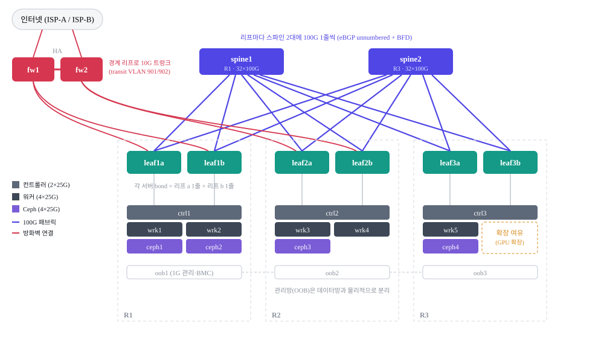
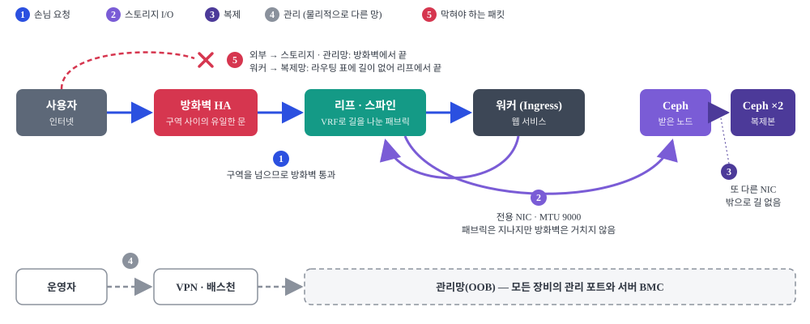

<div align="center">

# elice-infra

*Kubernetes·Ceph 웹 서비스를 위한 3랙 데이터센터 네트워크 — 설계를 YAML 한 장에 적고,
스위치 설정·IP 표·배선표·모니터링 대상을 생성하고, 같은 설정을 가상 패브릭에 올려 검증한다.*


<br>

### [제안서 PDF](elice-infra-proposal.pdf) · [쉬운 버전](elice-infra-proposal-easy.pdf) · [단계별 문서](docs/00-전체지도.md)

<br>

<table>
<tr>
<th width="50%">구조 — 스파인 2 · 리프 6 · 서버 12, 랙 3개</th>
<th width="50%">흐름 — 트래픽마다 길을 나눈다</th>
</tr>
<tr>
<td></td>
<td></td>
</tr>
<tr>
<td align="left">

- 리프는 랙마다 2대, 스파인은 **R1·R3에 한 대씩**
- 모든 서버 링크를 **리프 두 대에 나눠** 꽂는 이중 연결
- eBGP 언더레이 + **EVPN-VXLAN**, 스위치 사이 링크는 **BGP unnumbered**
- 핵심 장비(스파인, 방화벽, 컨트롤러)는 **서로 다른 랙에**

</td>
<td align="left">

- 손님 요청만 **방화벽**을 지나고, 열린 문은 공인 IP 하나의 80/443
- 워커 ↔ Ceph는 **스토리지 전용 25G×2, MTU 9000**, 방화벽 미경유
- Ceph 복제는 **또 다른 NIC**, 밖으로 나가는 길 없음
- 관리 접속은 **물리적으로 분리된 관리망**으로만

</td>
</tr>
</table>

</div>

## 프로젝트 개요

엘리스 인프라 네트워크 엔지니어 미니프로젝트 과제로, Kubernetes(컨트롤러 3, 워커 5)와 Ceph 4대를 랙 3개에 수용하는 데이터센터 네트워크를 설계했다.
설계의 출발점은 트래픽 종류마다 길을 따로 두는 것이다. 웹 요청, 스토리지 I/O, Ceph 복제, 관리 접속을 NIC·VLAN·VRF로 나누고, 구역 사이는 방화벽만 지나게 했다.

설계 값은 [`inventory/site.yml`](inventory/site.yml) 한 파일에 적고, 생성기가 여기서 스위치 설정, 서버 netplan, IP 표, 배선표(케이블 87개), NetBox 입력 데이터, Prometheus 수집 대상과 알람 기준값을 모두 만든다.
같은 설정을 containerlab에 그대로 올려 **32개 항목을 시험**했고, 배포와 점검은 Ansible 플레이북으로 랩에서 확인했다.

<details>
<summary><b>English summary</b></summary>
<br>

A take-home design for a 3-rack datacenter network hosting a Kubernetes cluster (3 control-plane, 5 workers) and a 4-node Ceph cluster. The fabric is a 2-spine / 6-leaf Clos with an eBGP underlay (BGP unnumbered, BFD) and an EVPN-VXLAN overlay. Traffic is separated by purpose: web traffic, storage I/O, Ceph replication and management each get their own NICs, VLANs and VRFs, and the firewall is the only path between zones. Every design value lives in a single YAML file; a Python generator renders switch configs, server netplan, the IP plan, the cabling schedule (87 cables), NetBox import data and Prometheus targets from it. The generated configs run unchanged on a 23-container containerlab fabric where 32 checks pass, including failover tests (link cut: 2/200 pings lost, spine down: 0/200).

</details>

## 검증 결과

생성된 설정을 그대로 올린 containerlab 패브릭(스위치 8 · 서버 12 · 방화벽 · 외부 사용자 · 관리자, 컨테이너 23대)에서 [`lab/test.sh`](lab/test.sh)로 시험한 결과.

| 분야 | 확인한 것 | 결과 |
|---|---|---|
| 언더레이 | 리프 6대 × 스파인 2대 BGP 세션 | **8 / 8** |
| 오버레이 | 랙을 넘는 같은 서브넷 통신, Ceph 점보 프레임 9000, 워커 → Ceph 직결, 서비스망 1500 제한 | **6 / 6** |
| 분리·보안 | 복제망 격리, 방화벽 허용·차단 9가지 | **11 / 11** |
| 서비스 노출 | VIP를 두 랙 경로로 나눠 받음, 해시 정책, ECMP 2갈래, 엉뚱한 경로 광고 거부 | **4 / 4** |
| 장애 | 서버 링크 1줄 단절 / 스파인 1대 다운 / VIP 노드 이탈 | 손실 **2/200** · **0/200** · 남은 노드 응답 |

Ansible [`check-fabric.yml`](automation/ansible/check-fabric.yml)은 스파인 링크 하나를 내리자 끊긴 포트와 ECMP가 한 갈래로 줄어든 리프를 지목했고, [`push-config.yml`](automation/ansible/push-config.yml)은 차이 미리보기 → 바뀐 줄만 반영 → 원복, 문법 오류 차단까지 확인했다.

## 구조

```
inventory/        설계 원장: site.yml(랙·장비·서버·VLAN·VRF·주소), fw-policy.yml(방화벽 정책)
tools/netgen.py   원장 점검 + 생성기 (validate / build)
templates/        Jinja2 템플릿: 스위치 FRR, 리프 데이터플레인, netplan, 랩
build/            생성물: 스위치 설정, 서버 netplan, IP 표, 배선표, NetBox CSV, 모니터링 대상
lab/              containerlab 검증 랩 (생성된 설정을 그대로 올림)
automation/       Ansible: push-config.yml(배포), check-fabric.yml(점검)
monitoring/       Prometheus 수집 설정, 알람 규칙, blackbox 모듈
proposal/         제안서 원고(HTML)와 그림, PDF 출력 스크립트
docs/             단계별 문서
```

## 빠른 시작

생성 — Python 3.11, `pip install pyyaml jinja2`

```bash
python tools/netgen.py validate   # 원장 점검만
python tools/netgen.py build      # build/, lab/ 생성
```

랩 — 리눅스 + Docker + [containerlab](https://containerlab.dev) (WSL2 Ubuntu에서 개발·측정. 컨테이너 23대, 메모리 약 1GB)

```bash
cd lab && ./deploy.sh && ./test.sh
```

## 명령

| 명령 | 하는 일 |
|---|---|
| `python tools/netgen.py validate` | IP 중복·대역 겹침, 서버 끝자리 규칙, 한쪽 리프에만 연결된 서버, 컨트롤러·Ingress 노드 랙 분산, 랙 전력 점검 |
| `python tools/netgen.py build` | 점검 후 `build/`(운영용)와 `lab/`(시험용) 생성 |
| `lab/deploy.sh` · `lab/destroy.sh` | 시험 패브릭 기동 / 철거 |
| `lab/test.sh` · `lab/test.sh quick` | 32개 항목 시험 / 장애 시험을 뺀 29개 |
| `ansible-playbook check-fabric.yml` | BGP 세션 수·VTEP·ECMP 2갈래를 원장 기준값과 비교 |
| `ansible-playbook push-config.yml --check --diff` | 바뀔 줄 미리보기. 빼면 한 대씩 반영하고 실패 시 중단 |
| `python proposal/build.py` · `proposal/print.ps1` | 제안서 HTML 조립 / PDF 출력 (`easy`를 붙이면 쉬운 버전) |

Ansible 인벤토리는 운영용 `build/ansible/hosts.yml`, 시험용 `lab/generated/ansible-hosts.yml` 둘 다 생성된다.

## 시험 환경과 운영 설계의 차이

| 항목 | 운영 설계 | 시험 환경 |
|---|---|---|
| 포트 이름 | EthernetN, ens{n}f{m} | ethN |
| 서버 이중 연결 | LACP + 리프 쪽 EVPN 멀티호밍 | active-backup bond |
| 방화벽 | NGFW 두 대 HA | fw1 한 대, nftables |
| 관리망, 통신사 회선 | 있음 | 없음 (외부 사용자·관리자 컨테이너로 대체) |
| QoS | 설계 | 미적용 |

## Roadmap

- [x] **설계 원장과 생성기** — 랙·장비·서버·주소를 YAML 한 장에, 설정·표·CSV는 생성
- [x] **시험 패브릭** — 생성 설정을 그대로 올려 32개 항목 통과
- [x] **배포·점검 자동화** — Ansible로 차이 미리보기, 한 대씩 반영, 원장 기준 점검
- [ ] **모니터링 실검증** — Prometheus 설정과 알람(기대 세션 수, MTU 경로 프로브)을 시험 패브릭에 붙여 실제로 울려 보기
- [ ] **NetBox를 원장으로** — 생성기 입력을 YAML에서 NetBox API로
- [ ] **EVPN 멀티호밍 재현** — 시험 환경의 active-backup bond를 LACP로 바꿔 운영 설계와의 차이 줄이기
