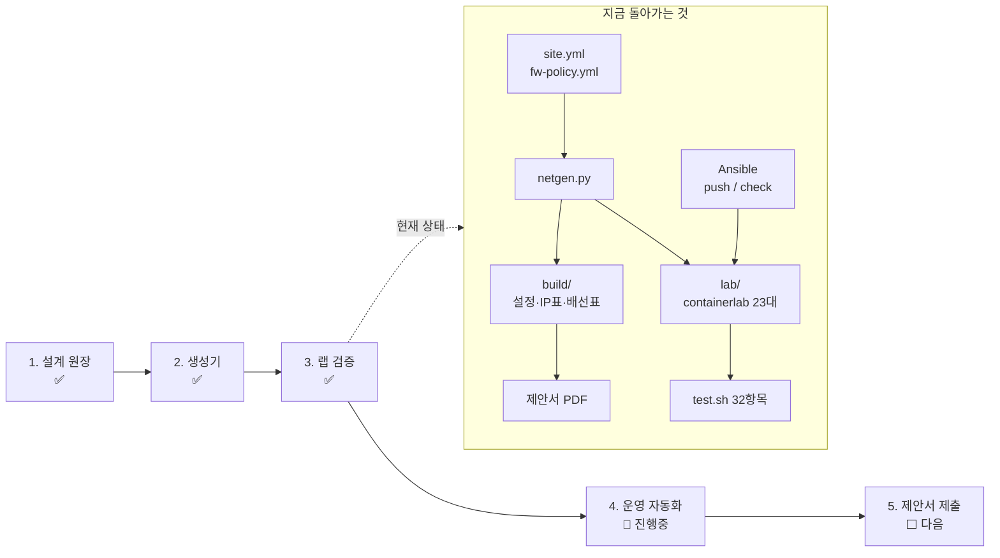

# elice-infra — 엘리스 미니프로젝트

## 요약

| | |
|---|---|
| **뭐냐** | 데이터센터 네트워크 설계서와, 그 설계서를 실제 설정으로 찍어내는 도장. 설계를 YAML 한 장에 적으면 스위치 설정·IP 표·배선표가 따라 나온다 |
| **왜** | 엘리스 인프라 네트워크 엔지니어 지원 과제. K8s 8대 + Ceph 4대를 3랙에 넣는 망을 제안하고 PDF로 제출해야 한다 |
| **지금** | 설계·생성·랩 검증(32/32 통과)·Ansible 시험 끝. 모니터링 설정은 랩에서 안 돌려 봤다. PDF는 검수 대기 |
| **실행** | `python tools/netgen.py build` → WSL에서 `cd lab && ./deploy.sh && ./test.sh` |

## 전체 그림

**읽는 법** — 사람은 왼쪽 원장(`site.yml`, `fw-policy.yml`)만 고친다. `netgen.py`가 운영용 설정(`build/`)과 랩(`lab/`)을 같은 원장에서 만들고, 랩에서 `test.sh`와 Ansible로 확인한 결과가 제안서 PDF에 들어간다.

## 설계 한 줄 요약

스파인 2 + 리프 6(랙당 2), eBGP 언더레이 + EVPN-VXLAN(랙이 달라도 같은 동네처럼 쓰게 하는 터널). 망은 VRF(라우팅 테이블을 아예 따로 쓰는 칸막이) 3개 — PROD, STORAGE, REPL — 와 물리 분리된 관리망. VRF 사이는 방화벽만 지난다. 세부 근거는 [제안서 원본](../proposal/proposal.html).

## 단계

| # | 하는 일 | 상태 | 문서 |
|---|---|---|---|
| 1 | 랙·장비·서버·IP·정책을 YAML에 적기 | ✅ 완료 | [01-설계원장](01-설계원장.md) |
| 2 | 원장 → 설정·표·CSV 생성, 원장 오류 차단 | ✅ 완료 | [02-생성기](02-생성기.md) |
| 3 | 생성 설정을 containerlab에 올려 32항목 시험 | ✅ 완료 | [03-랩검증](03-랩검증.md) |
| 4 | Ansible 배포·점검, 모니터링 설정 | 🔶 진행중 | [04-운영자동화](04-운영자동화.md) |
| 5 | 제안서 PDF 검수·제출 | ⬜ 다음 | [05-제안서제출](05-제안서제출.md) |

## 확장 방향성

- **모니터링 랩 연동** — clos-fabric에서 만든 Prometheus+자작 수집기를 이 랩에 붙이면 알람 규칙을 실제로 검증할 수 있다. 메트릭 이름이 지금은 추정이다
- **NetBox를 원장으로** — netgen 입력부만 NetBox API로 바꾸면 된다. 면접에서 운영 단계 질문이 나올 때 보여 줄 수 있다
- **ESI-LAG 재현** — FRR은 EVPN 멀티호밍을 지원한다. 랩의 active-backup bond를 LACP로 바꾸면 운영 설계와의 차이가 하나 줄어든다
- **GPU 백엔드** — roce-fabric 랩의 RoCE/ECN 경험을 13장 GPU 절에 연결할 수 있다

## 기록

- [README.md](../README.md) — 실행법, 랩과 운영의 차이, 함정
